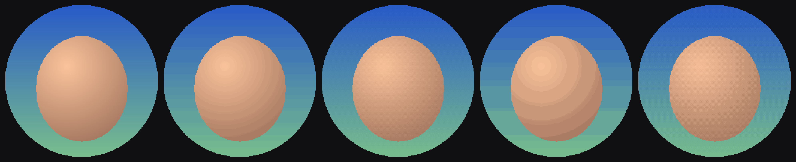
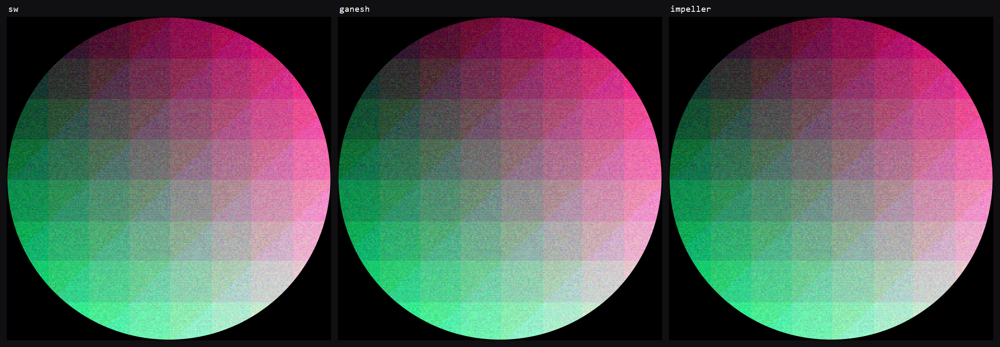

# Аватар 256×256 в пиксельном дожде: где тормозит и как ускорить

Исследование для алертов фоллоу / рейда / подписки (`UserAlertWidget` →
`RainyAvatar` → `AvatarPixelRain`) при повышении разрешения аватара до 256.
Целевой слабый ПК — Ryzen 7 3700X во время стрима.

## Коротко

- **Узкое место — растеризация на CPU, а не вычисления.** Плагин OBS рендерит
  Flutter программно (Skia на CPU, один raster-поток). Сейчас каждый из 51 040
  пикселей аватара — отдельный спрайт `drawRawAtlas` с билинейной выборкой и
  умножением на цвет. На модели 3700X это **28.6 мс растеризации на кадр →
  37.6 fps и 121 джанк** за 5 секунд входа; под нагрузкой — 34.8 fps.
- **Предрасчёт координат на все кадры не помогает**: координаты стоят
  0.2–2 мс, предрасчёт сэкономил 0.6 мс на кадр ценой 164 MiB и +350 мс
  подготовки.
- **Пререндер кадров-картинок работает** (UI-поток ≈ 0, 60 fps), но стоит
  371 MiB памяти и 1.6 с подготовки на 3700X. Растеризация при этом не дешевле
  лучшего варианта: смешивание целого кадра на CPU тоже дорогое. Полноразмерный
  пререндер (1920×1080) занял бы 2.4 ГБ.
- **Лучший вариант — `drawRawPoints`, сгруппированные по цвету**
  (4 бита на канал + дизеринг Байера). Skia рисует такие точки быстрым путём —
  сплошными прямоугольниками. Растеризация аватара сократилась с 25.4 до 7.6 мс
  на модели 3700X (в 3.3 раза), а на быстром ядре — с 8.1 до 1.3 мс. Стабильные
  60 fps, без дополнительной памяти.
- **Вариант с точными цветами без квантизации** — атлас из самой текстуры
  аватара (1 тексель на спрайт, nearest, без `modulate`): растеризация 10.1 мс
  вместо 25.4, тоже 60 fps.
- **Подготовку частиц обязательно увести в изолят.** Сейчас это 50–70 мс на
  UI-потоке в момент появления алерта на модели 3700X, а с группировкой по
  цвету ещё +55 мс.
- Стратегически проблему целиком снимает GPU-рендеринг в плагине (раздел 6).

**Обновление 12.10 — GPU-источник плагина (раздел 9):**

- На GPU-источнике в нынешнем виде (Skia Ganesh через ANGLE) рейтинг
  переворачивается: `contourPoints` стоит **25 мс растеризации на модели 3700X
  (~41 fps)**, хуже текущего `rawAtlas` (9.9 мс). Ganesh и ANGLE платят за
  каждый из сотен вызовов `drawRawPoints`.
- **С `--enable-impeller` в плагине** тот же `contourPoints` стоит 7.5 мс
  (59 fps), картинка совпадает с программной пиксель в пиксель. Это самый
  простой путь: один рендерер на оба источника.
- Самый дешёвый вариант на GPU с любым бэкендом — `texelAtlas` (4.7–5 мс).
- `glFinish` в `present` плагина даёт выбросы до 16–46 мс в raster-потоке;
  `glFlush` убирает их.

## 1. Почему это вообще дорого: окружение OBS

Приложение работает не в обычном Windows-раннере, а внутри OBS через
[`flutter_obs_source`](https://github.com/dealnotedev/flutter_obs_source):

- рендерер `kSoftware` — **Skia рисует на CPU**, GPU не участвует; вся
  растеризация кадра идёт в одном raster-потоке движка;
- platform- и UI-задачи крутятся в одном потоке на источник;
- каждый кадр перерисовывается целиком (без partial repaint), а затем
  копируется `memcpy` в слот для OBS (~0.5 мс на 1080p);
- vsync-коллбэка нет: движок тикает своим 60 Гц таймером; OBS (`obs.dll`)
  сам вызывает `timeBeginPeriod`, поэтому таймер внутри процесса точный.

Число частиц растёт квадратично с разрешением (берётся круг внутри квадрата):

| разрешение | частиц | относительно 48 |
|---:|---:|---:|
| 48 | 1 716 | 1× |
| 128 | 12 644 | 7× |
| 256 | 51 040 | 30× |

При `pixelSize = 8` аватар 256 занимает 2048 px и не помещается в 1080p,
поэтому для 256 замерялся `pixelSize = 3` (768 px). В программном рендеринге
стоимость определяется в основном **количеством примитивов**, а не их размером.

## 2. Методика

Всё лежит в `benchmark/avatar_rain/`:

| файл | что меряет |
|---|---|
| `host/avatar_bench_host.c` | минимальный embedder-хост: **тот же `flutter_engine.dll` из OBS**, `kSoftware`, объединённый platform/UI раннер, `memcpy` кадра — как в плагине. Считает реально отданные кадры и интервалы между ними |
| `pipeline_bench_main.dart` | приложение для хоста: настоящий `SubsWidget` + слой аватара с таймингами `UserAlertWidget` (вход 5 с / падение 3 с, уход волнами 2 с / 1.2 с). Собирает `FrameTiming` (build = UI-поток, raster = растеризация) |
| `compute_bench.dart` | AOT-замер чистой Dart-математики (текущий цикл кадра, SoA+LUT, подготовка частиц) |
| `raster_bench_test.dart` | микробенчмарк растеризации разных способов рисования через `flutter_tester` (тот же Skia CPU) |
| `quantization_preview_test.dart` | картинка «точные цвета / 5 бит / 4 бита, с дизерингом и без» |
| `host/cpu_load.c`, `host/cpu_sets.c` | генератор нагрузки и печать P/E-ядер |

`app.so` для хоста собирается штатным
`flutter build windows --release -t benchmark/avatar_rain/pipeline_bench_main.dart` —
snapshot-hash совпадает с тем, что ожидает кастомный движок из OBS
(`0451907c…`), т.е. это ровно тот путь, которым приложение попадает в OBS.

Процессор стенда — i7-14700F. Конфигурации:

- **P-ядра** (`--affinity 0000FFFF`) — быстрый ПК;
- **E-ядра** (`--affinity 0FFF0000`) — модель Ryzen 7 3700X. По скалярному коду
  E-ядро Gracemont близко к Zen 2 или чуть медленнее, но AVX2 оно исполняет
  128-битными половинками, а Zen 2 — полной шириной. Растеризатор Skia активно
  использует AVX2, поэтому для raster это **пессимистичная** модель: реальный
  3700X окажется между строками «P-ядра» и «E-ядра»;
- **E-ядра + нагрузка** — 12 потоков постоянной нагрузки на тех же 12 E-ядрах:
  потоки оверлея делят ядра с «игрой и OBS», как во время стрима.

Стенд не был выделенным (на машине параллельно шла обычная работа), поэтому
разброс между повторами доходит до ±10–20 %. Выводы опираются на разницу в
разы, а не на проценты.

## 3. Результаты на реальном движке OBS (1920×1080, аватар 256 / px 3)

Варианты слоя аватара (код — в `pipeline_bench_main.dart`):

| вариант | что это |
|---|---|
| `none` | без аватара, только `SubsWidget`: стоимость остальной сцены |
| `current` | `RainyAvatar` как сейчас: атлас со скруглённым квадратом, bilinear, `modulate` |
| `texelAtlas` | **облегчение текущего**: `drawRawAtlas`, где атлас — сама текстура аватара (1 тексель на спрайт), nearest, без массива цветов; SoA + LUT |
| `points4` | **`drawRawPoints` по цветам**: 4 бита/канал + дизеринг, один вызов на цвет; SoA + LUT |
| `points5` | то же, 5 бит/канал |
| `points5Frames` | **пререндер данных**: `points5`, но позиции всех кадров на 60 fps посчитаны заранее, при воспроизведении — только выбор кадра |
| `cellFrames` | **пререндер кадров**: каждый кадр на 60 fps заранее растеризован в картинку с одним текселем на ячейку аватара (640×360); при воспроизведении — один `drawImageRect` с апскейлом nearest |

`build` — время UI-потока на кадр, `raster` — растеризация кадра,
«аватар» = raster − raster(`none`). Потоки работают конвейером, поэтому
60 fps возможны, пока и build, и raster укладываются в ~16 мс с запасом.

### 3.1. Модель Ryzen 7 3700X (E-ядра), без нагрузки

| вариант | fps входа | кадров >25 мс | build p50 | raster p50 / p95 | аватар |
|---|---:|---:|---:|---:|---:|
| `none` | 59.4 | 0 | 0.2 | 3.2 / 5.2 | — |
| `current` 128/px8 (сегодняшний максимум) | 59.6 | 1 | 1.5 | 15.3 / 18.3 | 12.1 |
| **`current` 256/px3** | **37.6** | **121** | 4.9 | **28.6 / 36.0** | **25.4** |
| `texelAtlas` | 59.6 | 0 | 1.8 | 13.3 / 16.7 | 10.1 |
| **`points4`** | 59.4 | 2 | 1.8 | **10.8 / 13.8** | **7.6** |
| `points5` | 59.4 | 0 | 4.9 | 12.9 / 17.4 | 9.7 |
| `points5Frames` | 59.4 | 0 | 4.3 | 12.6 / 15.9 | 9.4 |
| `cellFrames` | 59.6 | 0 | **0.2** | 11.8 / 14.7 | 8.6 |

### 3.2. Модель 3700X под нагрузкой (12 потоков нагрузки на тех же 12 ядрах)

Нагрузка жёсткая: даже сцена без аватара даёт 59 кадров дольше 25 мс за счёт
планировщика. Поэтому сравнивать стоит с `none`.

| вариант | fps входа | кадров >25 мс | fps ухода | raster p50 / p95 |
|---|---:|---:|---:|---:|
| `none` | 58.0 | 59 | 58.8 | 2.3 / 3.6 |
| `current` 128/px8 | 53.1 | 41 | 54.9 | 14.4 / 29.5 |
| **`current` 256/px3** | **34.8** | **123** | **40.0** | 28.1 / 43.2 |
| `texelAtlas` | 54.0 | 49 | 56.1 | 12.8 / 21.6 |
| **`points4`** | **56.0** | 57 | **58.2** | **10.4 / 18.4** |
| `points5` | 50.1 | 61 | 46.0 | 12.4 / 22.8 |
| `points5Frames` | 50.0 | 62 | 53.4 | 12.4 / 24.5 |
| `cellFrames` | **58.1** | 44 | 57.2 | 11.7 / 20.8 |

### 3.3. Быстрый ПК (P-ядра i7-14700F), без нагрузки

Здесь все варианты держат 60 fps, разница видна только в стоимости кадра:

| вариант | build p50 | raster p50 | аватар |
|---|---:|---:|---:|
| `none` | 0.2 | 2.2 | — |
| `current` 128/px8 | 1.1 | 5.7 | 3.5 |
| `current` 256/px3 | 3.5 | 10.3 | 8.1 |
| `texelAtlas` | 1.3 | 6.6 | 4.4 |
| **`points4`** | 1.7 | **3.5** | **1.3** |
| `points5` | 3.3 | 4.7 | 2.5 |
| `points5Frames` | 3.0 | 4.7 | 2.5 |
| `cellFrames` | 0.1 | 4.7 | 2.5 |

### 3.4. Память и подготовка (вход + уход)

| вариант | доп. память | подготовка, P-ядро | подготовка, модель 3700X |
|---|---:|---:|---:|
| `current` (`preparePixels` ×2) | — | 28–38 мс | 50–70 мс |
| `texelAtlas` | ~1 MiB | +12 мс | +24 мс |
| `points4` | ~1 MiB | +29 мс | +55 мс |
| `points5` | ~1 MiB | +34 мс | +69 мс |
| `points5Frames` | **164 MiB** | +198 мс | +351 мс |
| `cellFrames` | **371 MiB** | +859 мс | **+1604 мс** |

## 4. Куда уходит время: Dart против растеризации

### 4.1. Dart-математика (AOT, `compute_bench.dart`, P-ядро)

| 256 частиц: 51 040 | время |
|---|---:|
| текущий цикл кадра, вход (`Curves.easeOut` = `Cubic` с бинарным поиском) | 1.2 мс (p95 2.2) |
| текущий цикл кадра, уход волнами (`Map.putIfAbsent` на каждый пиксель) | 2.1 мс (p95 2.8) |
| SoA (`Float32List`) + LUT на 1024 точки вместо `Cubic` | **0.16 мс** |
| подготовка `preparePixels` ×2 (вход + уход) | 28 мс |

Вывод: координаты дешёвые. Даже текущий код тратит на них 1–2 мс на P-ядре,
а SoA + LUT — 0.16 мс. **Предрасчитывать координаты бессмысленно**:
выигрыш ≤2 мс на кадр ценой 117 MiB (вход) + 47 MiB (уход) памяти. Это
подтверждено и на реальном движке (вариант `points5Frames` ниже).

Дорого другое — **разовая подготовка** на UI-потоке прямо в `initState`
алерта: 28–38 мс на P-ядре и 50–70 мс на модели 3700X. Это гарантированный
фриз 2–4 кадров в момент появления алерта.

### 4.2. Растеризация Skia на CPU (`raster_bench_test.dart`, `flutter_tester`, P-ядро)

Стоимость одного кадра 1920×1080 только для слоя аватара, все 51 040 частиц в полёте:

| способ рисования | 128/px8 | 256/px3 | 256/px8 |
|---|---:|---:|---:|
| текущий: атлас со скруглённым квадратом, `FilterQuality.low`, `modulate` цветом | 11.4 | 14.2 | 25.8 |
| то же, но квадрат и `FilterQuality.none` (просто `pixelRadius = 0`) | 8.6 | 10.7 | 17.5 |
| атлас = сама текстура аватара (1 тексель на спрайт), без цветов | 7.5 | 8.8 | 15.4 |
| `drawRect` на каждый пиксель (legacy) | 5.6 | — | — |
| **`drawRawPoints` по цветам, 4 бита/канал** | **2.0** | **2.4** | **3.1** |
| `drawRawPoints` по цветам, 3 бита/канал | 1.9 | 2.2 | 2.8 |
| готовый кадр в разрешении сетки, `drawImageRect` с апскейлом | 7.8 | 7.8 | 7.8 |
| готовый кадр 1920×1080, `drawImage` 1:1 | 5.7 | 5.7 | 5.7 |

Почему так:

- `drawRawAtlas` в программном Skia на каждый спрайт пересчитывает матрицу,
  обновляет шейдер-сэмплер и запускает растровый конвейер построчно. С
  `FilterQuality.low` (включается из-за `pixelRadius ≠ 0`) каждый пиксель
  ещё и билинейно сэмплится и умножается на цвет. Получается ~0.25 мкс на
  спрайт плюс дорогие пиксели.
- `drawRawPoints(PointMode.points)` с `StrokeCap.square`, без AA и без
  шейдера Skia рисует быстрым путём: каждая точка — прямоугольник
  сплошного цвета, построчный `memset`. Это ~0.04 мкс на точку. Ограничение
  одно: цвет задаётся на вызов, поэтому частицы группируются по
  квантованному цвету. Накладные расходы на вызов ~0.3 мкс, так что сотни и
  даже тысячи групп — нормально.
- Готовый кадр-картинка стоит одинаково при любом числе частиц, но это
  смешивание 1–2 млн пикселей каждый кадр (~3–4 нс на пиксель на CPU). Оно
  проигрывает точкам, которые трогают только ~460 тыс. реально закрашенных
  пикселей.

## 5. Разбор вариантов

### 5.1. Пререндер данных: координаты на все кадры заранее (`points5Frames`)

Идея: в момент события посчитать позиции всех частиц для каждого кадра на
60 fps (вход — 301 кадр, уход — 121), а при воспроизведении только выбирать
нужный массив.

- build: 4.3 мс против 4.9 у того же `points5` без предрасчёта (модель 3700X),
  raster не меняется;
- память: 117 MiB на вход + 47 MiB на уход;
- подготовка: +350 мс на модели 3700X.

**Не рекомендуется.** UI-поток тратит время не на математику (SoA + LUT —
0.16 мс на P-ядре), а на запись тысяч вызовов отрисовки в display list. А
растеризация от предрасчёта никак не зависит.

### 5.2. Пререндер кадров: каждый кадр — готовая картинка (`cellFrames`)

Идея: заранее растеризовать каждый кадр в изображение размером «сетка
аватара на весь экран» (при px 3 — 640×360, один тексель на ячейку,
выровнено по сетке аватара) и на каждом кадре рисовать одну картинку с
апскейлом nearest. Пиксели получаются точно квадратными, цвета — точные.

- UI-поток почти свободен (build 0.2 мс), растеризация **не зависит от числа
  частиц**: ~12 мс на модели 3700X, 4.7 мс на P-ядре на 1080p;
- под жёсткой нагрузкой это лучший результат (58.1 fps, на уровне сцены без
  аватара), но с небольшим отрывом от `points4` (56.0);
- **371 MiB** на один алерт и **1.6 с** подготовки на модели 3700X. Если
  одновременно идут фоллоу и рейд, память удваивается;
- стоимость растеризации растёт с размером холста: при 2560×1440 она примерно
  ×1.8, при 4K — ×4. Пререндер в полном разрешении 1920×1080 — 2.4 ГБ,
  нереально.

Можно улучшить: хранить кадры как 8-битные индексы палитры (~93 MiB) и
разворачивать в RGBA на кадр вперёд. Или не хранить вовсе и растеризовать
сетку в Dart в реальном времени: ~0.7 мс на P-ядре плюс асинхронный
`decodeImageFromPixels` ~0.25 мс, с задержкой в один кадр. Но растеризация
всё равно останется ~12 мс на модели 3700X, т.е. не лучше `points4`.
**Имеет смысл только если нужно ещё больше частиц или несколько аватаров
одновременно.**

### 5.3. Облегчение текущего: атлас из текстуры аватара (`texelAtlas`)

Минимальная правка существующего `drawRawAtlas`:

- атлас — не белый скруглённый квадрат 64×64, а сама картинка аватара
  256×256; каждый спрайт — один тексель, растянутый RSTransform до `pixelSize`;
- `FilterQuality.none` и без массива цветов, т.е. без `BlendMode.modulate`;
- SoA + LUT вместо `List<Pixel>` + `Curves.easeOut.transform` и без `Map` на
  каждый кадр.

Результат: растеризация аватара 10.1 мс вместо 25.4 (в 2.5 раза меньше), build
1.8 мс вместо 4.9; цвета точные. Ещё проще и чуть слабее — оставить всё как
есть, но поставить аватару `pixelRadius: Radius.zero`: квадратный атлас и
nearest-выборка дают в микробенчмарке −25 %.

### 5.4. Лучший: `drawRawPoints`, сгруппированные по цвету (`points4`)

Подготовка:

1. цвет каждой частицы квантуется до 4 бит на канал с упорядоченным
   дизерингом Байера 4×4 по позиции в сетке аватара;
2. частицы сортируются по квантованному цвету; на каждую группу — один
   `Paint` (цвет = средний цвет группы, `StrokeCap.square`,
   `strokeWidth = pixelSize`, без AA);
3. стартовые позиции, смещения и задержки складываются в `Float32List`
   в порядке групп.

Кадр: позиции считаются через LUT в один общий `Float32List`, затем на
каждую группу — `canvas.drawRawPoints(PointMode.points,
Float32List.sublistView(points, start * 2, end * 2), paint)`.

На синтетическом шумном аватаре получилось 1 239 групп (4 бита) и 6 736 групп
(5 бит). 5 бит выглядят чуть лучше, но тысячи вызовов дороже и в build, и в
raster, а под нагрузкой это уже заметно (50 fps против 56). **Рекомендуется
4 бита с дизерингом.**

Качество: ниже — точные цвета, 5 бит, 5 бит с дизерингом, 4 бита, 4 бита с
дизерингом. Это намеренно худший случай — плавные градиенты. Без дизеринга
видны полосы, с дизерингом 5 бит практически не отличить от оригинала,
4 бита дают лёгкое «зерно». В полёте частиц квантизация незаметна. Если
нужен идеальный финальный кадр, по окончании входа можно один раз нарисовать
точное изображение (`drawImageRect` текстуры аватара, nearest) — анимация в
этот момент уже стоит, кадры не генерируются.



Ограничения:

- пиксели квадратные: `StrokeCap.round` уходит в медленный путь Skia. При
  px 3 скругление в 1 px и так не видно;
- non-AA прямоугольники Skia снапятся к пиксельной сетке — для пиксель-арта
  это и нужно.

Проверить качество на своём аватаре (картинка появится в
`build/avatar_bench/quantization_preview.png`):

```bash
AVATAR=path/to/avatar.png flutter test benchmark/avatar_rain/quantization_preview_test.dart
```

### 5.5. Что ещё нашлось по дороге

- **Подготовка на UI-потоке.** `UserAlertWidget._prepareAvatarPixels`
  вызывает `RainyAvatar.preparePixels` дважды прямо в `initState`. На 256
  это 50–70 мс на модели 3700X (с группировкой по цвету — ещё +55 мс).
  Решение: `Isolate.run` с `img.Image` на входе и typed data на выходе;
  туда же — `img.decodeImage` из `RainyAvatar.loadImageFromUrl`, это
  JPEG-декодер на чистом Dart.
- **Текстовые дожди `SubsWidget`** (имя, описание, сердце, фон сердца) — это
  тот же `drawRawAtlas` со скруглённым атласом, хотя каждый из них
  одноцветный. С точками это ровно один `drawRawPoints` на текст. Фон сцены
  (`none`) стоит 3.2 мс растеризации на модели 3700X, часть из них уйдёт.
- **В текущем painter на каждый кадр создаётся `Map<int, double>`** для
  волн, а `Curves.easeOut` — это `Cubic` с бинарным поиском (~10 итераций на
  частицу). LUT убирает и то и другое.
- **Таймер:** плагин ждёт задачи через `SleepConditionVariableCS` с
  миллисекундными таймаутами. Это нормально только потому, что OBS сам
  вызывает `timeBeginPeriod`. Вне OBS без этого ожидание квантовалось бы по
  ~15.6 мс.

## 6. Стратегически: GPU-рендеринг в плагине

Корень проблемы — `kSoftware` в `flutter_obs_source`. Движок в OBS уже
содержит Impeller-бэкенды OpenGLES и Vulkan: в `flutter_engine.dll` есть
строки `Using the Impeller rendering backend (OpenGLESSDF/VulkanSDF)`. Если
плагин перейдёт на `FlutterOpenGLRendererConfig` через ANGLE/D3D11 (или
Vulkan) с общей текстурой для OBS (`gs_texture_open_shared`), то:

- 51 тысяча спрайтов на GPU — доли миллисекунды, любой из вариантов выше
  станет не нужен;
- пропадут полнокадровые `memcpy` и загрузка текстуры в OBS на каждом кадре;
- станут доступны фрагментные шейдеры и, при Impeller, `flutter_gpu` с
  вершинными шейдерами. Тогда анимацию можно считать целиком на GPU: в буфер
  один раз грузятся старт, цель, цвет и задержка, а на кадр передаётся только
  время.

Это отдельная заметная работа в плагине: контекст ANGLE, синхронизация с
графическим потоком OBS, жизненный цикл текстур. Поэтому её стоит делать
параллельно, а не вместо `points4`.

## 7. Рекомендуемый план

1. **Подготовка в изоляте** (`Isolate.run`): `preparePixels`, группировка
   по цвету, декодирование аватара. Убирает фриз 50–130 мс на старте алерта.
2. **Новый рендерер `AvatarPixelRenderer.points`** по схеме `points4`:
   SoA + LUT, `drawRawPoints` по группам цветов, 4 бита + дизеринг, по
   умолчанию. `rawAtlas` и `legacyCanvas` оставить в настройках как запасные.
   Ожидаемо: 60 fps на 3700X с запасом, растеризация аватара в 3.3 раза
   меньше.
3. Опционально — **точный финальный кадр** после входа.
4. **Перевести текстовые дожди `SubsWidget` на тот же рендерер.**
5. Если точные цвета важнее скорости — `texelAtlas` вместо `points4`:
   в 2.5 раза дешевле текущего.
6. Параллельно — оценить **GPU-путь в плагине** (раздел 6).

Пререндер — ни данных, ни кадров — **не рекомендуется** для 256: он не
обгоняет `points4` по растеризации и стоит сотни мегабайт.

## 8. Как воспроизвести

AOT-математика:

```bash
dart compile exe benchmark/avatar_rain/compute_bench.dart -o build/avatar_bench/compute_bench.exe
```

```bash
./build/avatar_bench/compute_bench.exe
```

Растеризация в `flutter_tester`:

```bash
flutter test benchmark/avatar_rain/raster_bench_test.dart
```

Сквозной бенчмарк на движке из OBS. Важно: `flutter build windows`
перезаписывает `build/windows/x64/runner/Release`, поэтому сначала сделай
резервную копию или потом пересобери обычный билд.

```bash
flutter build windows --release -t benchmark/avatar_rain/pipeline_bench_main.dart
```

Хост собирается MSVC из x64 Developer Command Prompt; `embedder.h` лежит в
SDK: `<flutter>/engine/src/flutter/shell/platform/embedder`.

```bash
cl /O2 /I D:\flutter\engine\src\flutter\shell\platform\embedder benchmark\avatar_rain\host\avatar_bench_host.c /Fe:build\avatar_bench\avatar_bench_host.exe
```

```bash
./build/avatar_bench/avatar_bench_host.exe "C:\Program Files\obs-studio\obs-plugins\64bit\flutter_engine.dll" build/windows/x64/runner/Release/data 1920 1080 --affinity 0FFF0000
```

`--affinity` — маска логических процессоров (`cpu_sets.exe` печатает, какие
из них E-ядра). Нагрузка: `cpu_load.exe <потоки> <секунды> [маска]`;
собирается так же через `cl`.

GPU-режим хоста (см. раздел 9) собирается вместе с
`host/gpu_renderer.cpp` (`cl ... avatar_bench_host.c gpu_renderer.cpp`) и
включается флагами `--gpu [--gl-flush] [--impeller] [--angle <dir>]`. Набор
сценариев выбирается при сборке бандла:
`--dart-define=BENCH_SET=renderers` (по умолчанию, рендереры из `lib/`) или
`--dart-define=BENCH_SET=research` (исходное сравнение прототипов).
`flutter test benchmark/avatar_rain/renderer_sanity_test.dart` проверяет, что
все прототипы рисуют одинаковые пиксели.

## 9. Обновление 12.10: GPU-источник плагина

### 9.1. Что изменилось и как мерил

В плагине появился второй источник — «Freydis Overlay (GPU)»
(коммит `06b8a63`): `kOpenGL` через собственную сборку ANGLE поверх D3D11
на адаптере OBS. Кадр рендерится в pbuffer из D3D11-текстуры, в `present`
вызывается `glFinish`, затем `CopyResource` в shared-текстуру с keyed mutex.
Impeller не включён, т.е. рисует **Skia Ganesh** (GLES → ANGLE → D3D11).

В хост добавлен режим `--gpu` (`host/gpu_renderer.cpp`), повторяющий
`GpuRenderer` плагина без OBS. ANGLE берётся из OBS (сборка CEF, март 2025),
а не та, что собрана для плагина: цифры могут немного отличаться, проверить
можно через `--angle <папка angle плагина>`.

Бенчмарк теперь рисует **настоящими рендерерами из `lib/`**: `current` =
`rawAtlas`, `contourPoints` без сглаживания и со сглаживанием. Плюс три
прототипа под GPU:

- `texelAtlas` — один `drawRawAtlas`, атлас = текстура аватара, без цветов;
- `vertices` — один `drawVertices`: по 2 треугольника на частицу, цвета в
  вершинах;
- `cellTexture` — сетка аватара на весь экран (640×360) каждый кадр
  растеризуется в Dart, заливается в текстуру и рисуется одним
  `drawImageRect` с nearest, с задержкой в кадр; без пререндера.

Все варианты на тестовом аватаре рисуют одинаковые 112 968 пикселей
(`renderer_sanity_test.dart`).

Стенд 12.10 был шумнее, чем 9.10: даже сцена без аватара давала ~20 кадров
дольше 25 мс в любой конфигурации. Поэтому сравнивать стоит стоимость кадра
(build / raster p50), fps — только относительно `none`. Сырые логи —
`benchmark/avatar_rain/results/renderers_*.txt`.

### 9.2. Модель 3700X (E-ядра): программный против GPU

build / raster p50, мс. «GPU как в плагине» — с `glFinish`, в его raster входит
ожидание GPU. «GPU + glFlush» — чистая CPU-стоимость кадра.

| вариант (256/px3) | программный | fps | GPU как в плагине | fps | GPU + glFlush |
|---|---:|---:|---:|---:|---:|
| `none` | 0.3 / 4.8 | 59.0 | 0.4 / 1.4 | 58.8 | 0.3 / 0.8 |
| `current` 128/px8 | 1.6 / 15.4 | 54.2 | 2.0 / 3.8 | 52.9 | 1.8 / 3.3 |
| `current` (`rawAtlas`) | 5.1 / **29.8** | **34.8** | 5.3 / 9.9 | 48.6 | 5.3 / 9.3 |
| **`contourPoints`** | 2.8 / **11.2** | **54.5** | 2.7 / **25.4** | **41.4** | 2.7 / 25.3 |
| `contourPoints` + сглаживание | 2.8 / 11.2 | 53.7 | 2.7 / 25.1 | 41.2 | 2.6 / 24.7 |
| **`texelAtlas`** | 2.0 / 14.2 | 52.7 | 2.2 / 10.5 | 52.3 | 2.1 / **5.0** |
| `vertices` | 4.1 / 55.6 | 18.4 | 4.2 / 31.9 | 27.5 | 4.1 / 29.4 |
| `cellTexture` | 3.7 / 12.4 | 51.7 | 4.0 / 1.1 | 50.4 | 5.9 / **0.8** |

### 9.3. Быстрый ПК (P-ядра), GPU как в плагине

| вариант (256/px3) | build | raster p50 / p95 | fps |
|---|---:|---:|---:|
| `none` | 0.3 | 0.9 / 1.8 | 58.8 |
| `current` | 3.7 | 5.2 / 12.8 | 54.0 |
| `contourPoints` | 1.9 | **16.4** / 17.3 | 59.4 |
| `contourPoints` + сглаживание | 1.8 | 17.3 / 21.5 | 55.6 |
| `texelAtlas` | 1.4 | **3.1** / 4.6 | 59.0 |
| `vertices` | 3.6 | 16.7 / 18.7 | 59.8 |
| `cellTexture` | 2.4 | 4.3 / 6.3 | 59.4 |

### 9.4. Impeller вместо Ganesh (`--enable-impeller`)

В движке из OBS уже есть Impeller-бэкенд GLES. Хост с флагом `--impeller`
передаёт движку `--enable-impeller`, и тот печатает
`Using the Impeller rendering backend (OpenGLES)` — на ANGLE он работает.
build / raster p50, мс, GPU + `glFlush`:

| вариант (256/px3) | Ganesh, 3700X | **Impeller, 3700X** | fps | Impeller, быстрый ПК |
|---|---:|---:|---:|---:|
| `none` | 0.3 / 0.8 | 0.4 / 1.6 | 58.6 | 0.3 / 0.9 |
| `current` 128/px8 | 1.8 / 3.3 | 1.9 / 3.1 | 53.5 | 2.0 / 2.7 |
| `current` (`rawAtlas`) | 5.3 / 9.3 | 5.5 / 8.3 | 49.5 | 3.9 / 6.0 |
| **`contourPoints`** | 2.7 / **25.3** | 2.7 / **7.5** | **59.4** | 2.4 / 3.3 |
| `contourPoints` + сглаживание | 2.6 / 24.7 | 2.7 / 7.8 | 59.6 | 2.4 / 3.5 |
| **`texelAtlas`** | 2.1 / 5.0 | 2.1 / **4.7** | 59.6 | 1.4 / 3.2 |
| `vertices` | 4.1 / 29.4 | 4.3 / 8.6 | 50.3 | 3.3 / 6.3 |
| `cellTexture` | 5.9 / 0.8 | 4.4 / 0.9 | 47.4 | 4.4 / 0.7 |

С Impeller `contourPoints` на модели 3700X стоит в **3.4 раза меньше**, чем с
Ganesh, и снова оказывается среди лучших вариантов. Пустая сцена у Impeller
чуть дороже (1.6 против 0.8 мс).

**Картинка та же.** С флагом `--dump` хост сохраняет последний кадр входа;
`host/compare_dumps.ps1` сравнивает область аватара с программным рендером
(`results/backend_comparison.txt`). Для `current`, `contourPoints`,
`texelAtlas`, `vertices` и `cellTexture` кадры Ganesh и Impeller **совпадают
с программными пиксель в пиксель**. У `contourPoints` со сглаживанием
отличаются 2.4–2.7 тыс. пикселей из 590 тыс. — сглаживание кругов на краю
контура:



Проверены только сцены алертов. Остальной интерфейс (плеер, настройки,
текст) под Impeller нужно посмотреть отдельно в OBS.

### 9.5. Выводы

1. **С GPU-источником в нынешнем виде (Ganesh) `contourPoints` — худший из
   практичных вариантов.** На модели 3700X растеризация 25 мс (в 2.5 раза
   больше, чем у `rawAtlas`), ~41 fps; сглаживание на это не влияет. Ganesh
   не склеивает сотни вызовов `drawRawPoints`, а ANGLE платит за каждый.
2. **С Impeller эта проблема исчезает:** `contourPoints` — 7.5 мс, 59 fps,
   картинка идентична. Тогда один и тот же рендерер хорош на обоих
   источниках.
3. На программном источнике `contourPoints` по-прежнему лучший (11.2 мс
   против 29.8 у `rawAtlas`), а сглаживание при целом `pixelSize` бесплатно.
   Это подтверждает выводы разделов 3–5 уже на реальной реализации.
4. **GPU не делает 51 тысячу спрайтов бесплатными.** И Ganesh, и Impeller
   готовят геометрию каждого спрайта на CPU в raster-потоке: `rawAtlas`
   подешевел с 29.8 до 8–10 мс, но не до нуля.
5. **Самый дешёвый вариант на GPU — `texelAtlas`**: один `drawRawAtlas` с
   текстурой аватара, точные цвета, без `modulate`. 4.7–5.0 мс растеризации и
   2.1 мс build на модели 3700X, ~3 мс на быстром ПК — на обоих бэкендах.
6. `vertices` плох везде: 306 тысяч вершин копируются в display list и
   ещё раз в бэкенд. Использовать не стоит.
7. `cellTexture` почти не тратит raster (<1 мс), но переносит 4–6 мс на
   UI-поток (заполнение буфера + цепочка асинхронной загрузки) и грузит
   IO-поток. fps от этого не выросли. Быстрой победы тут нет.
8. **`glFinish` в `present` блокирует raster-поток.** С ним `present` в
   среднем 0.5–5 мс с выбросами до 16–46 мс; с `glFlush` максимум ≤ 3 мс, а
   raster `texelAtlas` на Ganesh падает с 10.5 до 5.0 мс. По fps и джанкам
   разница утонула в шуме стенда — это стоит проверить уже в OBS.

### 9.6. Что делать

1. **Плагин, GPU-источник: включить Impeller** — добавить `--enable-impeller`
   в `command_line_argv` при инициализации движка для GPU-рендерера. Это одна
   строка, и тогда текущий `contourPoints` подходит обоим источникам. Перед
   этим проверить в OBS остальной интерфейс под Impeller.
2. **Плагин: в `GpuRenderer::present` заменить `glFinish` на `glFlush`.**
   ANGLE и `CopyResource` работают на одном immediate context того же
   D3D11-устройства, поэтому порядок на GPU сохраняется. Синхронизацию с OBS
   по-прежнему обеспечивает keyed mutex.
3. **Если Impeller включать не хочется** — на GPU-источнике не использовать
   `contourPoints`: взять `rawAtlas` или перенести в `lib/` `texelAtlas`.
   Для автоматического выбора плагин должен сообщать Dart, какой он
   рендерер (полем в ответе `get_dart_config` или отдельным запросом в канале
   `obs_config`), а в настройках появится значение «авто».
4. Опционально — `texelAtlas` как ещё один рендерер: точные цвета и самый
   дешёвый вариант на GPU. На программном источнике он уступает
   `contourPoints` (14.2 против 11.2 мс).
